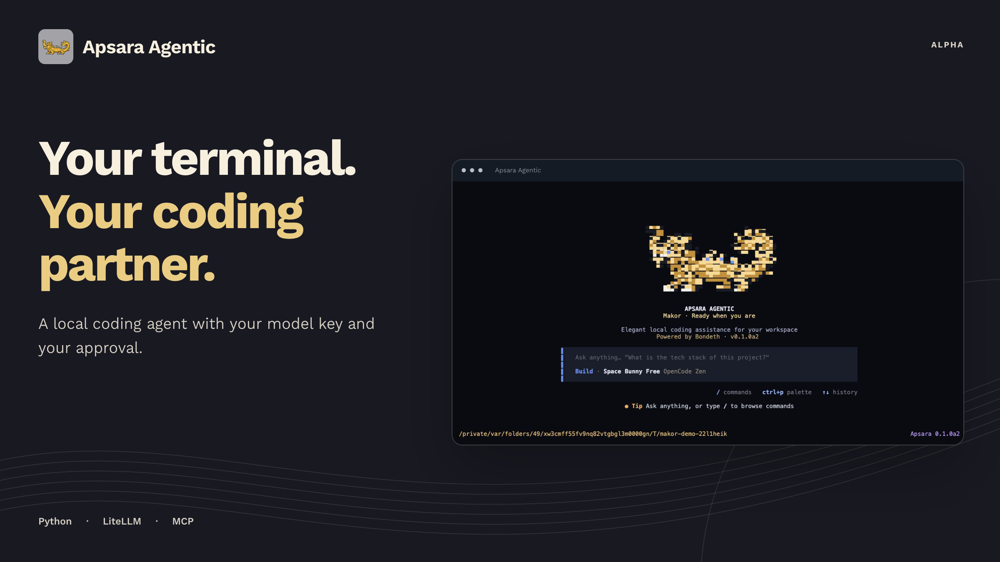
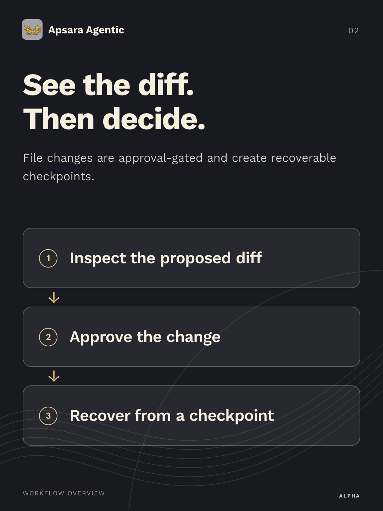
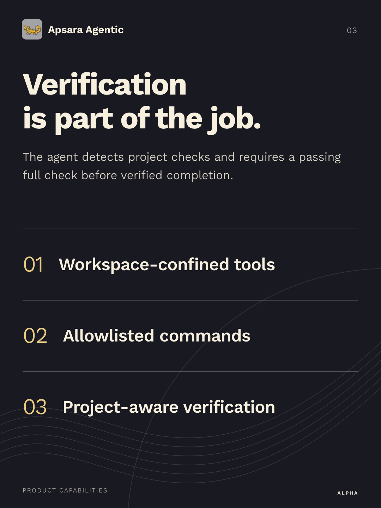

# Apsara Agentic

A local, bring-your-own-key coding agent for your terminal. Apsara reads and
edits code in a workspace you choose, runs allowlisted commands, and connects to
external tools over MCP — using your own API key, with no Apsara server in the
middle.

> **Alpha.** The CLI is usable day to day, but interfaces may still change
> between releases.

<!-- product-images:start -->

## Product preview

<p align="center">
  
</p>

<table>
<tr>
  <td width="33%"></td>
  <td width="33%"></td>
  <td width="33%"></td>
</tr>
</table>

<!-- product-images:end -->

## Requirements

- Python 3.10 or newer
- `git` on your PATH (for the `git_status` / `git_diff` tools)
- An API key from a model provider, or a local Ollama install

## Install

```bash
pipx install apsara-agentic
```

Python code intelligence works out of the box. For parser-accurate symbols and
syntax diagnostics in JavaScript, TypeScript, Go, Rust, Java, Ruby, PHP, C#,
C++, and C, install the optional Tree-sitter extra:

```bash
pipx install 'apsara-agentic[intelligence]'
```

Or, if you'd rather install through npm (it wraps the same Python package):

```bash
npm install -g apsara-cli
```

## Quickstart

```bash
apsara login
```

Pick a provider (OpenCode Zen, OpenAI, Anthropic, Google, Groq, Mistral,
DeepSeek, or local Ollama) and paste your own API key. It's verified immediately and stored in
`~/.apsara/credentials.json` with owner-only permissions. Nothing is sent to an
Apsara server — there isn't one.

```bash
cd /path/to/your/project
apsara init
```

That creates `.apsara/config.toml`, adds Apsara's local artifacts to
`.gitignore`, and opens chat in the current project. After that:

```bash
apsara chat
```

## Commands

| Command                      | What it does                                                          |
| ---------------------------- | --------------------------------------------------------------------- |
| `apsara chat`                | Interactive session in the current workspace                          |
| `apsara run "<instruction>"` | One-shot instruction, then exit                                       |
| `apsara init`                | Set up `.apsara/` in this project and start chatting                  |
| `apsara sessions`            | List saved sessions for a workspace                                   |
| `apsara mcp`                 | List configured MCP servers and verify they connect                   |
| `apsara trust`               | Review or revoke approvals for this project's plugins and MCP servers |
| `apsara doctor`              | Check environment, config, tools, and credentials                     |
| `apsara eval suite.json`     | Score recorded runs against regression expectations                   |
| `apsara login` / `logout`    | Manage stored provider keys                                           |
| `apsara --version`           | Print the installed version                                           |

Run `apsara <command> --help` for the full flag list.

## Tools

The agent works through a workspace-scoped tool sandbox. Every path is resolved
inside the workspace root; attempts to escape it fail.

**Reading** — `read_file`, `parallel_read_files`, `read_file_lines`, `glob_search`,
`search_files`, `repository_map`, `find_symbol`, `list_project_structure`,
`list_symbols`, `go_to_definition`, `find_references`, `code_diagnostics`,
`git_status`, `git_diff`, `git_log`, `git_show`, `git_blame`

**Writing** — `edit_file`, `replace_file_lines`, `write_to_file`,
`replace_symbol`, `create_directory`, `move_file`, `delete_file`

**Commands** — `run_bash_command` plus cancellable background processes via
`start_process`, `process_output`, `list_processes`, and `stop_process`; off by
default, see below.

Before every file mutation Apsara creates a recoverable checkpoint under
`.apsara/checkpoints/`. Use `/undo` for the latest edit, `/checkpoints` to list
snapshots, or `/undo <id>` to restore a specific one. `/diff` shows Git status
plus staged and unstaged patches before you accept or undo a change.

Every agent turn also owns an atomic checkpoint under `.apsara/turns/`.
`/turns` lists completed and interrupted turns, while `/undo-turn [id]` restores
all captured paths from one turn. Built-in file tools are captured lazily;
before an enabled command runs, Apsara snapshots the workspace up to 100 MB
(excluding dependency, build, Git, and Apsara state directories). Set
`APSARA_TURN_SNAPSHOT_MAX_MB` to change that ceiling. Set
`APSARA_ROLLBACK_FAILED_TURNS=1` to automatically roll back changed turns that
end failed or blocked; the default preserves work for review.

`edit_file` is the primary editing tool: it replaces an exact snippet of text
and refuses ambiguous or missing matches, so an edit can't silently land in the
wrong place after earlier changes shift the file. `replace_file_lines` still
exists for the rare case with no unique text to match on.

`replace_symbol` uses an AST or Tree-sitter source span to replace one complete
definition and refuses ambiguous or pattern-only matches. Every source edit is
followed by a fast syntax check. The agent can request a full project diagnostic
separately; Apsara selects Pyright, `tsc`, `go test`, or `cargo check` from the
project manifest and installed tools.

Every write shows a diff preview and asks for approval. In the prompt, `Enter`
approves, `n` rejects, `a` approves the rest of the session, `v` shows the full
patch, and `e` opens it in `$EDITOR`.

In the full-screen interface, approvals and diff review stay inside Apsara as a
keyboard-driven overlay (`Enter`/`y` approve, `n`/`Esc` reject, `a` always,
`v` toggles the full patch, and arrows scroll). Resumed sessions restore their
saved user and final-assistant messages directly into the transcript.

### Command execution

The bash tool is disabled by default. Enable it with an explicit allowlist:

```bash
apsara chat --allow-bash --allowed-commands @verify,git
```

`@verify` is a preset covering the usual test and build tools — `pytest`,
`python`, `npm`, `npx`, `node`, `tsc`, `jest`, `vitest`, `go`, `cargo`, `make`,
`mvn`, `gradle`, `dotnet`, `ruff`, `mypy`, and friends. `@read` and `@git` are
also available, and you can mix presets with plain command names.

**Turn this on.** Without a test runner on the allowlist the agent can write
code but never run it, so it can't catch its own mistakes — you get
single-shot generation instead of an agent that iterates until the suite is
green.

Commands are parsed and checked against the allowlist — including every stage of
a pipe or `&&` chain — and redirections that would write outside the workspace
are rejected. Each command still needs your approval at run time unless you pass
`--auto-approve`. A single command is killed after `--bash-timeout` seconds
(default 120).

## MCP servers

Apsara is an MCP client, so it can use any Model Context Protocol server:
filesystem, git, GitHub, databases, browser automation, or your own internal
tools. Declare servers in `.apsara/config.toml`:

```toml
# Launched as a subprocess over stdio
[mcp_servers.filesystem]
command = "npx"
args = ["-y", "@modelcontextprotocol/server-filesystem", "."]

# Reached over streamable HTTP
[mcp_servers.internal]
url = "https://mcp.example.com/v1"
headers = { Authorization = "Bearer ${MCP_TOKEN}" }
timeout = 30
```

`$VAR` and `${VAR}` are expanded from the environment, so tokens stay out of the
config file. Set `enabled = false` to keep a server defined but switched off.

Their tools appear to the agent as `mcp__<server>__<tool>` and cannot collide
with the built-ins. Servers connect once per session, and a server that fails to
start is reported and skipped rather than taking the session down.
Read-like MCP tools can run normally; tools that appear to mutate external state
show their arguments and require approval. `--read-only` blocks those actions.

Check your setup any time:

```bash
apsara mcp
```

## Trust

Two things can arrive with a repository rather than from you: local plugins in
`.apsara/tools/*.py` and MCP server definitions in `.apsara/config.toml`. Both
execute code, so Apsara asks before running either one, showing what it's about
to execute. Approvals are recorded per project in `~/.apsara/trust.json`, keyed
by a digest of the code — if an approved file changes, you're asked again.

`--auto-approve` does **not** cover this. That flag waives confirmation for file
writes; it is not consent to execute a project's code.

Review what you've approved, or take it back:

```bash
apsara trust           # list approvals for this project
apsara trust --reset   # revoke them all
```

## Configuration

Settings resolve in this order: CLI flags → project `.apsara/config.toml` →
global `~/.apsara/config.toml` → built-in defaults. A project `.env` is read
only for an explicit allowlist of provider credential keys; repository files
cannot change token limits, fallbacks, pricing paths, or provider endpoints.

```toml
[defaults]
workspace = "."
model = "opencode/big-pickle"
session = "default"
stateless = false
allow_bash = false
allowed_commands = ["@verify", "@git"]
bash_timeout = 120
max_file_size = 1000000
auto_approve = false
color = true

[ui]
welcome_title = "Welcome to Apsara Agentic"
welcome_subtitle = "A focused terminal coding assistant"
welcome_animation = true
```

The default is `opencode/big-pickle`, called through OpenCode Zen's
OpenAI-compatible endpoint. Set `OPENCODE_API_KEY`, or choose OpenCode during
`apsara login`. Big Pickle is free for a limited period; OpenCode states that
submitted data may be used to improve the model during that period, so choose a
different provider for confidential repositories. `--model` and the config
file can still select any supported LiteLLM model.

For provider resilience, set a comma-separated fallback chain. Apsara switches
only when a request fails before emitting output. A free or local model will
only fall back automatically to another known free/local model, so a temporary
outage cannot silently create a provider bill:

```bash
export APSARA_FALLBACK_MODELS="ollama/llama3.2,groq/llama-3.3-70b-versatile"
```

Paid models remain available through `--model` or `/model`; Apsara shows a
billing warning and requires confirmation before an interactive switch.

Useful flags:

- `--workspace <path>` — the directory the agent may access
- `--model <name>` — any model LiteLLM can route to
- `--read-only` — disable every destructive tool
- `--dry-run` — preview changes without touching disk
- `--auto-approve` — skip write confirmations
- `--stateless` — don't load or save session history
- `--config <path>` — use a specific config file

## Sessions

Conversations are saved as JSON under `.apsara-cli/sessions/` in the workspace —
local files, no database. Long conversations are summarized and trimmed
automatically to stay within the model's context budget, while the full history
stays on disk.

The budget is derived from the selected model's context window, so a
200k-window model gets a far larger working set than a 32k one. `/status` shows
the current usage against both. `APSARA_INPUT_TOKEN_BUDGET` may lower the
working budget, but it cannot exceed the selected model's safety allowance or
the global 128k input ceiling. Cap per-turn tool calls with `APSARA_MAX_STEPS`.

Token counts are provider-reported and aggregated across every model call in an
agent turn, including automatic conversation summaries. If a streaming provider
omits usage—or a call is interrupted—Apsara keeps a separate local estimate and
never adds it to provider-reported totals or cost. These counters measure session
telemetry and context capacity, not an Apsara fee, secure quota, or billing ledger.
The provider dashboard remains authoritative.

Big Pickle currently displays `$0.0000 promo`, based on OpenCode's temporary-free
listing verified on 2026-08-09. Promotional pricing expires from Apsara's trusted
snapshot after 30 days unless re-verified, so the CLI cannot silently claim that a
temporary model stays free forever. Local models remain `$0`; when current pricing
is unavailable Apsara displays `provider billed` instead of inventing a cost.

Usage totals persist with named sessions and are restored when a session is
reopened. The CLI separates input, output, cache-read, cache-write, and reasoning
tokens when the provider reports those fields. Provider rate-limit counters and
reset times also appear in `/status` and the TUI sidebar when available.
`/usage` provides a local-only rollup for the current session, saved sessions,
and each model. It reads editable local JSON files and never uploads telemetry;
deleting or modifying those files changes the local display but cannot alter the
provider's metering, limits, or invoice.

For paid models, Apsara calculates a directional cost from provider-reported
tokens and LiteLLM's maintained public list-price metadata. That metadata is
cached under `~/.apsara/pricing.json` and refreshed in the background every 24
hours. The UI marks these amounts as `list` because free quotas, negotiated
rates, batching, regional pricing, taxes, and provider-side rounding can make
the final invoice different. Missing pricing remains `provider billed`; Apsara
never substitutes an invented rate.

Each turn also writes an append-only event trace and typed run state beneath
`.apsara/runs/`. `/report` exports the latest run as Markdown. Durable project
facts live in the transparent `.apsara/memory.md` file; use `/memory show` and
`/memory add <note>` to manage them.

`apsara eval evals/coding-core.json --live` runs disposable Python, TypeScript,
Go, and Rust coding tasks and scores verification, edit scope, tool efficiency,
and tokens. Saved `results.json` evidence can be re-scored offline with
`--results`; see [the evaluation strategy](docs/EVALUATION_STRATEGY.md).

In chat, `/help` lists the complete command surface, including `/details`,
`/history`, `/tools`, `/model`, `/session`, `/add`, `/processes`, `/logs`,
`/stop`, `/diff`, `/turns`, `/undo-turn`, `/undo`, `/usage`, `/memory`,
`/report`, `/save`, and `/bug`.

In the full-screen TUI, press `Ctrl+C` while a turn is running to cancel that
turn without closing Apsara. Press it again while idle to exit.

## Extending with local plugins

Drop a Python file in `.apsara/tools/` that exports `METADATA` and `run()`:

```python
METADATA = {
    "name": "ticket_lookup",
    "description": "Fetch a ticket summary by id.",
    "parameters": {
        "type": "object",
        "properties": {"ticket_id": {"type": "string"}},
        "required": ["ticket_id"],
    },
}

def run(ticket_id: str) -> str:
    return f"Ticket {ticket_id}: ..."
```

You'll be asked to approve it the first time it loads. For anything you'd want
to share across projects or teams, prefer an MCP server.

Optionally place a same-named JSON manifest beside the plugin, for example
`.apsara/tools/ticket_lookup.json`:

```json
{
  "name": "ticket_lookup",
  "description": "Fetch a ticket summary by id",
  "version": "1.0.0",
  "enabled": true,
  "permissions": ["network"]
}
```

Invalid manifests are rejected, disabled plugins are skipped, and manifest
changes invalidate the recorded trust digest.

## Evaluation

Recorded runs make agent behavior reproducible without paying for another model
call. An evaluation suite references run IDs and expected state/tools:

```json
{
  "cases": [
    {
      "name": "edit smoke",
      "run_id": "abc123",
      "expect": {
        "state": "completed",
        "tools": ["edit_file"],
        "max_tool_calls": 10
      }
    }
  ]
}
```

Run it with `apsara eval suite.json --workspace .`. The command exits non-zero
when a case fails, so it can be used in CI.

## Development

```bash
git clone https://github.com/RithyBondeth/Apsara-Agentic-Cli.git
cd Apsara-Agentic-Cli
python -m pip install -e ".[dev]"
python -m pytest
```

Local run notes are in
[RUN_PROJECT.md](https://github.com/RithyBondeth/Apsara-Agentic-Cli/blob/main/RUN_PROJECT.md),
tester setup is in
[TESTER_QUICKSTART.md](https://github.com/RithyBondeth/Apsara-Agentic-Cli/blob/main/TESTER_QUICKSTART.md),
and the runtime design is in [`docs/AGENT_RUNTIME.md`](docs/AGENT_RUNTIME.md).
Maintainers: see `RELEASING.md` in the repository for the publish process.

## License

MIT — see [LICENSE](https://github.com/RithyBondeth/Apsara-Agentic-Cli/blob/main/LICENSE).
